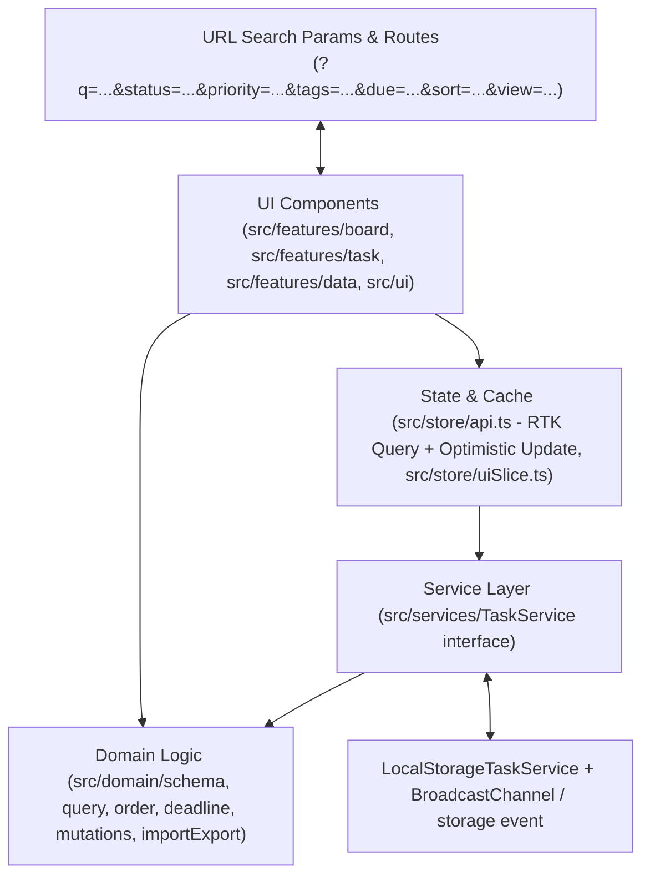

# Task Board

Ứng dụng quản lý công việc viết bằng **React 19** và **TypeScript (`strict`)**, hỗ trợ hai chế độ xem **Danh sách** và **Kanban** kéo thả, tìm kiếm tiếng Việt không dấu, lọc đa điều kiện, tự động cảnh báo hạn chót theo thời gian thực và đồng bộ đa tab.

- **Demo trực tiếp (Vercel):** https://task-board-nlvu.vercel.app
- **GitHub Repository:** https://github.com/ItsNLVu/task-board

## 1. Cài đặt, chạy dev và chạy test

Yêu cầu môi trường: **Node.js >= 20**, **npm >= 10**.

```bash
# Cài đặt dependencies
npm install

# Chạy môi trường dev (Vite HMR)
npm run dev

# Chạy toàn bộ kiểm tra (ESLint + Prettier + TypeScript + Vitest + Build)
npm run check

# Chạy unit test và component test (Vitest + Testing Library)
npm test

# Chạy E2E test trên Chromium (Playwright)
npm run test:e2e

# Build production và chạy thử bản build tại http://localhost:4173
npm run build
npm run preview
```

## 2. Kiến trúc và luồng dữ liệu

### Sơ đồ phân tầng



### Cấu trúc thư mục

```text
src/
  app/                Cấu hình Router, Redux Provider, CSS tokens (Light/Dark) và Ant Design theme
  common/             Hằng số và hàm dùng chung: định dạng ngày giờ (dateTime.ts), key lưu trữ (storageKeys.ts), hằng số thời gian UI (constants.ts)
  i18n/               Quản lý ngôn ngữ VI/EN bằng file JSON (locales/vi.json, locales/en.json) kết hợp kiểm tra type-safe bằng TypeScript
  domain/             Type, Zod schema và các hàm xử lý thuần: tìm kiếm bỏ dấu, lọc, sắp xếp, tính order khi kéo thả, kiểm tra deadline, import/export
  services/           Interface TaskService bất đồng bộ, bản cài đặt LocalStorageTaskService, giả lập lỗi API và đồng bộ đa tab
  store/              Redux store, RTK Query (taskApi xử lý optimistic update & rollback) và uiSlice
  features/
    board/
      header/         Các nút trên thanh điều hướng: chuyển chế độ xem, đổi ngôn ngữ VI/EN, đổi giao diện Sáng/Tối
      filters/        Các control lọc: PrioritySelect, TagFilter, DueSelect, SortSelect, MobileFilterControls
      list/           Chia hàng cho chế độ Danh sách, vạch thời gian "Bây giờ", vùng thả đổi trạng thái nhanh
      kanban/         Card kéo thả trong cột Kanban kèm khung giữ chỗ khi đang kéo
      states/         Trạng thái bảng trống (nạp dữ liệu mẫu), đang tải, lỗi và không khớp bộ lọc
      BoardPage.tsx   Trang chính kết nối URL params, RTK Query và hai chế độ xem
      TopBar.tsx      Thanh điều hướng đầu trang
      StatsBar.tsx    Thanh thống kê nhanh kiêm nút lọc theo trạng thái và quá hạn
      FilterBar.tsx   Thanh tìm kiếm, lọc và sắp xếp
      ListView.tsx    Chế độ xem Danh sách có virtualization
      KanbanView.tsx  Chế độ xem Kanban 3 cột kéo thả
    task/
      primitives/     Component hiển thị cơ bản: PriorityBadge, StatusIcon, DeadlineLabel, Highlight, TagList, SubtaskProgress
      form/           Các trường nhập liệu dùng chung: FormField, DeadlineStatusRow, PriorityTagsRow
      TaskCard.tsx    Thẻ công việc, hỗ trợ đổi nhanh trạng thái và mở chi tiết
      TaskForm.tsx    Form tạo/sửa task dùng React Hook Form + Zod
      SubtaskEditor.tsx Thêm, sửa, xóa, tick và kéo thả sắp xếp subtask
      TaskMeta.tsx    Hiển thị thời gian tạo, cập nhật và hoàn thành của task
      TaskModalRoute.tsx Modal chi tiết/tạo mới gắn với route /tasks/:taskId và /tasks/new
    data/             Menu Dữ liệu (nạp 50 hoặc 1.000 task mẫu, xuất/nhập file JSON, bật/tắt giả lập lỗi API)
  ui/                 Component giao diện dùng lại (ConfirmDialog, FilterChip)
  lib/                Tiện ích độc lập (đồng hồ cập nhật mỗi phút useNow, tải file, đọc/ghi localStorage)
```

### Luồng dữ liệu và quản lý state

Ứng dụng tách state thành 3 phần theo đúng vai trò:

1. **Dữ liệu Task (`RTK Query - taskApi`)**: Component không gọi `localStorage` trực tiếp mà chỉ gọi hook của RTK Query (`useGetTasksQuery`, `useCreateTaskMutation`, `useUpdateTaskMutation`, `useMoveTaskMutation`, `useDeleteTaskMutation`, `useRestoreTaskMutation`). Khi người dùng thao tác, UI cập nhật ngay trên cache (`onQueryStarted` + `updateQueryData`). Nếu `TaskService` báo lỗi, `patch.undo()` khôi phục lại dữ liệu cũ và hiển thị thông báo lỗi.
2. **Trạng thái lọc, sắp xếp và điều hướng (`React Router URL`)**: Các tham số `view`, `q`, `status`, `priority`, `tags`, `due`, `sort` và route `/tasks/:taskId` đều phản ánh trên URL. Nhấn `F5` hoặc copy link gửi sang tab khác sẽ mở lại đúng bộ lọc và đúng task đang xem.
3. **Trạng thái UI tạm thời (`uiSlice`)**: Lưu ID của thẻ vừa mở modal để khi đóng modal, ứng dụng cuộn tới và trả lại focus về đúng thẻ đó.

## 3. Lý do chọn thư viện

- **Quản lý state (`Redux Toolkit` + `RTK Query`)**: Đề bài yêu cầu giao tiếp qua một tầng service bất đồng bộ và phải có optimistic update kèm rollback khi lỗi. RTK Query giải quyết bài toán này gọn hơn việc tự viết state `loading/error/rollback` thủ công trong từng slice: toàn bộ logic cập nhật trước và `patch.undo()` khi lỗi nằm tập trung trong `src/store/api.ts`. Khi sau này đổi `LocalStorageTaskService` sang REST/GraphQL API thật, tầng component và store gần như không phải sửa.
- **Form và Validation (`React Hook Form` + `Zod`)**: Form task có nhiều trường phụ thuộc lẫn nhau (kiểm tra trùng tiêu đề giữa các task chưa hoàn thành, kiểm tra deadline không ở quá khứ khi tạo mới hoặc khi đổi sang mốc mới, danh sách subtask động). `Zod` cho phép viết một schema duy nhất (`src/domain/schema.ts`) rồi dùng chung cho cả 3 nơi: validate trên Form, validate ở tầng `LocalStorageTaskService` và validate từng bản ghi khi nhập file JSON.
- **Kéo thả (`@dnd-kit/core` + `@dnd-kit/sortable`)**: Hỗ trợ kéo thả mượt bằng cả chuột, màn hình cảm ứng và bàn phím (`Space` + phím mũi tên), đồng thời phối hợp tốt với danh sách dùng virtualization.
- **Virtualization (`@tanstack/react-virtual`)**: Thay vì dùng phân trang làm đứt mạch khi kéo thả hoặc lọc nhanh, virtualization chỉ render các hàng/thẻ nằm trong vùng nhìn thấy của màn hình. Khi nạp thử **1.000 task**, số node DOM thực tế chỉ khoảng vài chục thẻ, thao tác cuộn và gõ tìm kiếm không bị giật.
- **UI Components (`Ant Design` + `Tailwind CSS`)**: Tận dụng các component phức tạp đã xử lý sẵn accessibility của Ant Design (`Modal`, `Drawer`, `Select`, `DatePicker`, `Upload.Dragger`, `Notification`) kết hợp Tailwind CSS để căn chỉnh layout linh hoạt và đồng bộ biến màu Sáng/Tối.

## 4. Các đánh đổi (Trade-offs) và hướng cải thiện nếu có thêm thời gian

### Các đánh đổi đã chấp nhận

1. **Lọc và sắp xếp trên client thay vì đẩy xuống tầng service**:
   - Do toàn bộ dữ liệu hiện lưu trong `localStorage` (quy mô vài chục đến vài nghìn task), việc đọc danh sách một lần qua `getTasks` rồi lọc/sắp xếp trên bộ nhớ với `useMemo` và `WeakMap` cache chuỗi bỏ dấu giúp thao tác lọc và tìm kiếm phản hồi tức thì (< 5ms với 1.000 task), đồng thời tính được số liệu thống kê đầu trang chính xác.
   - Đánh đổi: Nếu chuyển sang backend thật với hàng chục nghìn task trở lên, cần đưa bộ lọc và phân trang/cursor xuống query của API.
2. **Tính `order` theo giá trị trung bình (`(prev + next) / 2`)**:
   - Khi kéo một thẻ vào giữa hai thẻ khác, chỉ cần cập nhật `order` của đúng thẻ vừa kéo thay vì đánh số lại cả cột. Nếu kéo thả nhiều lần vào cùng một khe khiến khoảng cách nhỏ hơn `1e-6`, hệ thống mới đánh số lại cột đó theo bước `1024`.
3. **Modal sửa task lưu theo nút "Lưu thay đổi" thay vì auto-save từng phím gõ**:
   - Giúp người dùng sửa thử nhiều trường (tiêu đề, deadline, subtask) rồi mới chốt lưu một lần, đồng thời dễ dàng hủy bỏ nếu đổi ý (có hộp thoại cảnh báo khi đóng modal mà chưa lưu). Riêng ngoài bảng chính, các thao tác đổi trạng thái nhanh và kéo thả đều lưu ngay lập tức.

### Những gì sẽ làm tiếp nếu có thêm thời gian

- Viết thêm `HttpTaskService` kết nối backend thật (Node.js/PostgreSQL) và WebSocket/SSE để đồng bộ giữa nhiều thiết bị.
- Hỗ trợ chọn nhiều card cùng lúc (bulk select) để đổi trạng thái, gán tag hoặc xóa hàng loạt.
- Thêm lịch sử thay đổi (activity log) cho từng task trong Modal.

## 5. Danh sách tính năng

### Đã hoàn thành

- **Khởi tạo & Dữ liệu mẫu**:
  - [x] Định nghĩa đầy đủ kiểu `Task` và `Subtask` với TypeScript `strict`.
  - [x] Tự sinh 50 task mẫu đa dạng trạng thái/hạn chót và có nút "Nạp dữ liệu mẫu" khi bảng trống cũng như trong menu `Dữ liệu` (kèm tùy chọn nạp 1.000 task để test hiệu năng).
- **A. Quản lý danh sách (Dashboard)**:
  - [x] Card hiển thị đầy đủ: tiêu đề, badge Priority có màu, Deadline tương đối ("còn 2 giờ", "quá hạn 1 ngày", rê chuột xem giờ chính xác `HH:mm, dd/MM/yyyy`), danh sách tag, tiến độ subtask (`done/total`).
  - [x] Sắp xếp theo: Deadline gần nhất, Mới tạo nhất, Priority (`Urgent -> Low`), Cập nhật gần nhất và Thứ tự kéo thả.
  - [x] Tìm kiếm real-time theo tiêu đề và mô tả (hỗ trợ cả tiếng Việt không dấu), debounce `300ms`, tô sáng (`<mark>`) từ khóa khớp trên cả tiêu đề và mô tả.
  - [x] Lọc kết hợp: nhiều Status, nhiều Priority, theo Tag, theo khoảng Deadline (`Hôm nay`, `Tuần này`, `Quá hạn`), có nút "Xóa bộ lọc" và bộ đếm số kết quả (`x / tổng`).
  - [x] Thống kê nhanh đầu trang: tổng số task, số lượng theo từng Status, số task quá hạn, tỉ lệ hoàn thành (`%`).
  - [x] Hiển thị mượt với 1.000 task nhờ `@tanstack/react-virtual`.
- **B. Chế độ Kanban**:
  - [x] 3 cột tương ứng 3 Status (`Cần làm`, `Đang làm`, `Hoàn thành`), chuyển đổi qua lại với chế độ Danh sách.
  - [x] Kéo thả Card giữa các cột để đổi Status (tự động cập nhật/xóa `completedAt`) và kéo thả trong cùng cột để đổi thứ tự (`order`).
  - [x] Bộ lọc và tìm kiếm áp dụng đồng nhất cho cả Kanban và Danh sách.
- **C. Popup chi tiết và chỉnh sửa (Task Modal)**:
  - [x] Xem toàn bộ thông tin task, bao gồm `createdAt`, `updatedAt`, `completedAt`.
  - [x] Chỉnh sửa trực tiếp mọi trường, dùng chung Zod schema với form tạo mới.
  - [x] Thêm, sửa tên, xóa, tick hoàn thành và kéo thả sắp xếp subtask ngay trong Modal.
  - [x] Cảnh báo khi đóng Modal (`Esc`, nút đóng, click ra ngoài, nút Back trình duyệt hoặc tải lại trang) mà còn thay đổi chưa lưu.
  - [x] Xóa có hộp thoại xác nhận; sau khi xóa hiện thông báo có nút **Hoàn tác (Undo)** trong 5 giây.
  - [x] Đồng bộ URL `/tasks/:taskId` (copy link và `F5` mở lại đúng task; nếu task không tồn tại thì hiển thị thông báo lỗi thân thiện kèm nút quay về bảng).
  - [x] Hỗ trợ đóng bằng phím `Esc`, focus trap trong Modal và trả focus về lại đúng Card sau khi đóng.
- **D. Logic Deadline**:
  - [x] Task chưa `done` mà quá hạn hiển thị nhãn cảnh báo "Quá hạn" nổi bật trên cả Card và Modal.
  - [x] Task chưa `done` và còn dưới 24 giờ hiển thị nhãn "Sắp hết hạn" với màu cảnh báo riêng.
  - [x] Trạng thái hạn chót tự động cập nhật mỗi phút theo thời gian thực (`useNow`) mà không cần tải lại trang.
- **E. Lưu trữ và đồng bộ**:
  - [x] Mọi thao tác thêm, sửa, xóa, kéo thả, đổi trạng thái đều đi qua tầng `TaskService` bất đồng bộ.
  - [x] Optimistic update: giao diện cập nhật ngay, tự động rollback và báo lỗi nếu service thất bại (có công tắc "Mô phỏng lỗi API 30%" trong menu `Dữ liệu` để kiểm tra trực tiếp).
  - [x] Nhấn `F5` khôi phục toàn bộ dữ liệu, chế độ xem, bộ lọc, sắp xếp và từ khóa tìm kiếm.
  - [x] Đồng bộ đa tab tức thì qua `BroadcastChannel` và sự kiện `storage`.
  - [x] Xuất toàn bộ task ra file JSON; nhập lại từ file JSON có bước kiểm tra schema, thống kê số bản ghi hợp lệ và báo rõ từng bản ghi lỗi trước khi nhập.
- **Bổ sung thêm**:
  - [x] Giao diện Sáng / Tối (Light / Dark Mode) và chuyển đổi ngôn ngữ Tiếng Việt / Tiếng Anh (`VI` / `EN`).

### Chưa hoàn thành

- Không có.
